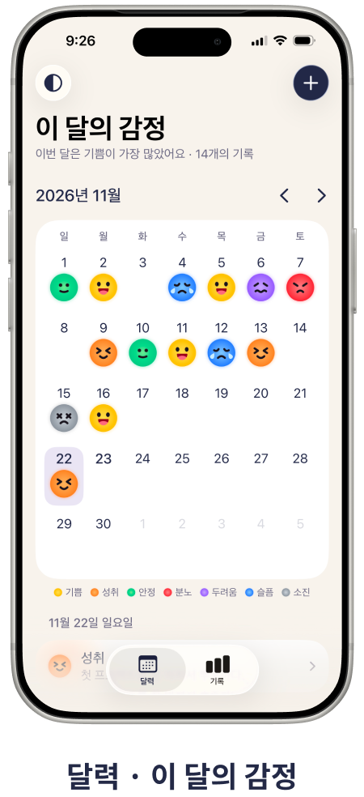
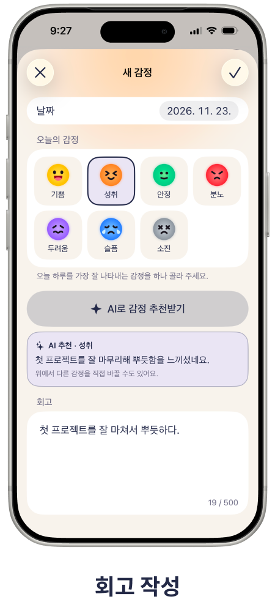
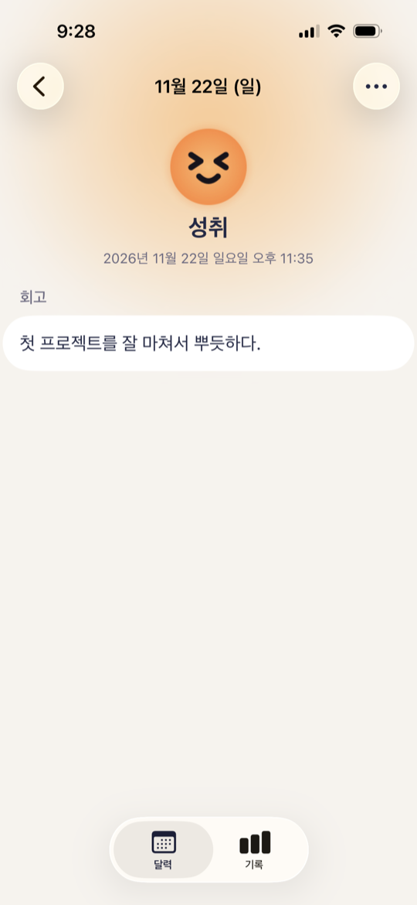
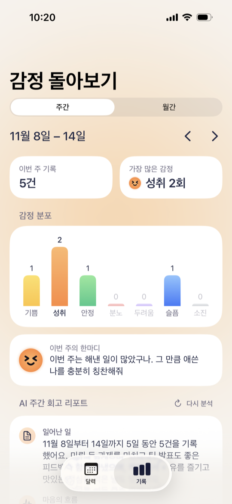
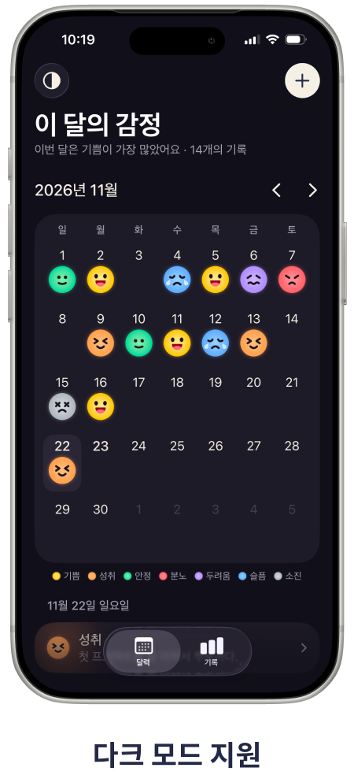

<div align="center">
  <picture>
    <source media="(prefers-color-scheme: dark)" srcset="firstProject/firstProject/Assets.xcassets/AppIcon.appiconset/AppLogo_Dark.png">
    <source media="(prefers-color-scheme: light)" srcset="firstProject/firstProject/Assets.xcassets/AppIcon.appiconset/AppLogo_Light.png">
    
  </picture>

  <h1>Feelo</h1>
  <p><strong>오늘의 감정을 색으로 남겨요</strong></p>
  <p>하루의 회고를 짧은 글로 기록하고 7가지 감정 색(아우라)으로 남겨,<br/>한 주와 한 달의 감정 흐름을 달력과 통계, AI 리포트로 한눈에 돌아보는 iOS 감정 회고 앱</p>

  <p>
    
    
    
    
    
    
  </p>
</div>

## 대표 앱 화면

<div align="center">

<table>
  <tr>
    <td align="center" width="270"></td>
    <td align="center" width="270"></td>
    <td align="center" width="270"></td>
  </tr>
  <tr>
    <td valign="top" align="center" width="270">날짜별 감정 아우라와<br/>최다 감정 요약, 하단 범례</td>
    <td valign="top" align="center" width="270">감정 선택, AI 추천 감정과 이유,<br/>500자 입력</td>
    <td valign="top" align="center" width="270">감정 배경과 작성 일시,<br/>회고 전문, 편집·삭제 메뉴</td>
  </tr>
</table>

<table>
  <tr>
    <td align="center" width="270"></td>
    <td align="center" width="270"></td>
  </tr>
  <tr>
    <td valign="top" align="center" width="270">감정 분포 막대 그래프, 주간 한마디,<br/>6단계 AI 리포트</td>
    <td valign="top" align="center" width="270">같은 화면을 다크 테마로 표시</td>
  </tr>
</table>

</div>

> 화면의 기록은 시연을 위해 넣은 예시 데이터입니다.

## 프로젝트 개요

* **팀명:** 오졌조 (EST Team 5)
* **개발 기간:** `2026.11.16 (월)` ~ `2026.11.22 (일)`
* **기획 의도:** 하루의 회고를 부담 없이 짧은 글로 남기고, 7가지 감정 색으로 시각화하여 주간·월간 감정 흐름을 직관적으로 돌아볼 수 있도록 설계했습니다.
* **지원 환경:**
  * **OS:** iOS 17.0 이상
  * **디바이스:** iPhone 세로 모드 전용 (`TARGETED_DEVICE_FAMILY = 1`, `UIInterfaceOrientationPortrait`) — iPad 및 macOS 미지원
  * **언어:** 앱 문구는 한국어로만 제공하고 날짜 표기는 `ko_KR`로 고정합니다. (다국어 미지원)

## 핵심 기능

### 1. 온보딩 (`WelcomeView`)
* 앱 최초 실행 시 `@AppStorage("hasSeenWelcome")` 값을 확인해 온보딩 화면을 표시합니다.
* 7가지 감정 아우라 일러스트와 브랜드 로고를 배치하고, **시작하기** 버튼을 누르면 메인 탭 화면으로 전환됩니다.

### 2. 회고 작성 · 열람 · 편집 · 삭제 (CRUD)
* **작성 및 편집 (`RetrospectiveWriteView`):**
  * 미래 날짜 선택을 제한한 팝오버 그래픽 `DatePicker`로 오늘 또는 지난 날짜의 회고를 기록할 수 있습니다.
  * 최대 **500자** 텍스트 입력과 실시간 글자 수 카운터(`RetrospectiveDraft.clampContent()`)를 제공합니다.
  * 작성 중인 변경 사항이 있을 때 닫기 또는 스와이프 종료를 시도하면 확인 얼럿(`interactiveDismissDisabled`)으로 데이터 유실을 방지합니다.
  * 감정을 선택하면 상단 배경에 해당 감정의 아우라 워시(`EmotionWash`)가 부드럽게 전환됩니다.
* **열람 및 삭제 (`RetrospectiveDetailView`):**
  * 기록한 감정 아우라, 작성 일시, 회고 전문을 확인하고 우측 상단 `Menu`에서 **회고 편집** 시트를 열거나 삭제 확인 얼럿을 거쳐 안전하게 삭제할 수 있습니다.

### 3. 7가지 감정 분류 및 AI 감정 추천
* 복잡한 다중 태그 대신 하루의 핵심 정서를 직관적으로 분류할 수 있도록 **7가지 감정 분류(`Emotion`)** 를 적용했습니다.
* 회고 본문을 작성한 뒤 **AI로 감정 추천받기** 버튼을 누르면 `EmotionRecommender`가 Firebase 서버를 거쳐 OpenAI API(`json_schema` strict 모드)를 호출해 가장 어울리는 감정 1개와 60자 이내의 근거 문장을 추천합니다.
* AI 추천 이후에도 사용자가 상단 감정 카드에서 원하는 감정으로 언제든 직접 변경할 수 있습니다.

| 감정 | 영문 식별자 (`rawValue`) | 아우라 에셋 |
| :--- | :--- | :--- |
| **기쁨** | `joy` | `joyAura` / `joyAuraStart`–`End` |
| **성취** | `achievement` | `achievementAura` / `achievementAuraStart`–`End` |
| **안정** | `stable` | `stableAura` / `stableAuraStart`–`End` |
| **분노** | `angry` | `angryAura` / `angryAuraStart`–`End` |
| **두려움** | `fear` | `fearAura` / `fearAuraStart`–`End` |
| **슬픔** | `sad` | `sadAura` / `sadAuraStart`–`End` |
| **소진** | `exhausted` | `exhaustedAura` / `exhaustedAuraStart`–`End` |

### 4. 월간 감정 달력 및 일별 조회 (`달력` 탭)
* `RetrospectiveListView`와 `CalendarView`를 통해 해당 월의 최다 감정 요약 문구, 월 이동 네비게이션, 7색 감정 달력, 하단 범례를 한눈에 보여줍니다.
* 같은 날 여러 건의 회고를 남긴 경우 달력에는 가장 최근 작성한 감정을 표시하고, 하단 목록에서 최신 작성 순으로 전체 카드를 확인할 수 있습니다.
* 기록이 없는 날짜는 `EmptyDayCard`로 상태에 맞는 안내를 보여줍니다. 오늘이면서 회고가 하나도 없으면 "첫 회고", 오늘은 "오늘 하루는 어땠나요?", 지난 날은 "이날은 기록이 없어요"와 함께 작성 버튼을 제공하고, 미래 날짜는 버튼 없이 안내만 표시합니다.

### 5. 주간 · 월간 통계 및 AI 주간 회고 리포트 (`기록` 탭)
* **기간 전환 및 요약 (`StatisticsView`):** `Picker(.segmented)`로 **주간 / 월간**을 전환하고, 총 기록 건수와 가장 많이 기록한 감정을 요약 카드로 제공합니다. 최다 감정에 맞춰 화면 배경에 `EmotionWash`를 표현합니다.
* **감정 분포 막대 차트 (`EmotionBarChart`):** 7가지 감정의 기록 횟수를 그라데이션 막대 그래프로 시각화하고 최다 감정을 강조 표시합니다.
* **기간별 공감 한마디 (`StatisticsFeedbackCard`):** 해당 기간 최다 감정에 맞는 주간·월간 맞춤 응원/위로 문구(`Emotion+Feedback`)를 표시합니다.
* **AI 주간 회고 리포트 (`WeeklyAIReportSection`, `WeeklyReflectionAnalyzer`):** 주간 통계에서 **AI 주간 분석 시작하기**를 누르면 앱이 사전 계산한 통계 수치와 회고 본문을 Firebase 서버를 거쳐 OpenAI API로 전달해 **6가지 사고 모델** 관점으로 정리해 줍니다.
  * **일어난 일** (`facts`) · **마음의 흐름** (`emotionalFlow`) · **좋았던 순간** (`positives`) · **마음 쓰인 일** (`regrets`) · **작은 힌트** (`solutions`) · **이번 주 한줄** (`summary`)

## 데이터 저장

| 저장 방식 | 대상 키 / 모델 | 관리 데이터 및 역할 |
| :--- | :--- | :--- |
| **`SwiftData`** | `@Model final class Retrospective` | 회고 본문 영구 저장 (`date: Date`, `content: String`, `emotionRaw: String`, `createdAt: Date`) |
| **`@AppStorage`** | `"hasSeenWelcome"` (`Bool`) | 최초 실행 온보딩 완료 여부 저장 |
| **`@AppStorage`** | `"appTheme"` (`AppTheme`) | 사용자 화면 테마 설정 저장 (`system`, `light`, `dark`) |

> 데이터 모델의 자세한 구조(ERD)는 [`docs/ERD.md`](docs/ERD.md)를 참고하세요.

## UI/UX · 접근성 · 성능 최적화

### SwiftUI 네이티브 컴포넌트 및 다크 모드
* `TabView`, `NavigationStack`, `ScrollView`, `LazyVGrid`, `DatePicker`, `Picker`, `Menu`, `TextEditor`, `sheet`, `popover`, `alert` 등 SwiftUI 네이티브 컴포넌트를 우선 사용했습니다.
* `Assets.xcassets`에 라이트·다크 모드 대응 Color Set(`BgApp`, `BgCard`, `BgSelected`, `BorderDashed`, `TextPrimary`, `TextSecondary`, `TintPrimary`, `TintOnPrimary`, `StatusDestructive`, 7종 Aura Start/End)과 Image Set(앱 아이콘, 로고, AI 아이콘, 7종 감정)을 구성했습니다.
* `달력` 탭 좌측 상단 테마 메뉴에서 **시스템 / 라이트 / 다크** 모드를 즉시 전환할 수 있으며, `preferredColorScheme`으로 앱 전체에 반영됩니다.

### 접근성 (Dynamic Type & VoiceOver)
* **동적 글꼴 크기 대응:**
  * 접근성 큰 글꼴(`.accessibility1` 이상) 설정 시 7칸 달력 레이아웃이 깨지지 않도록 달력 대신 날짜별 목록인 `DayListView`로 자동 전환하고(그 달에 기록이 없으면 빈 상태 카드), 상단 요약 문구를 숨깁니다.
  * `AnyLayout`을 활용해 요약 카드(`StatisticsView`), 빈 상태 카드(`EmptyDayCard`), 공감 카드(`StatisticsFeedbackCard`), 날짜 행(`RetrospectiveWriteView`)을 가로(`HStack`)에서 세로(`VStack`)로 자동 재배치합니다.
  * `ViewThatFits`로 달력 하단 감정 범례를 1줄 → 3열 → 2열 그리드로 자동 조정하며, 감정 선택 그리드(`EmotionPickerCard`)는 글꼴 크기에 따라 4열 → 3열 → 2열로 유연하게 변경됩니다.
  * `@ScaledMetric`으로 아이콘·마커·셀 높이를 글꼴 크기에 비례해 스케일링합니다.
* **VoiceOver 지원:**
  * 달력 날짜 셀에 날짜와 기록 감정을 함께 읽어 주는 `.accessibilityLabel`을 제공하고, 막대 차트(`EmotionBarChart`)는 전체 분포를 요약해 `.accessibilityValue`로 안내합니다.
  * 선택된 감정 카드에 `.isSelected` 트레이트를 부여하고, 장식용 아우라·배경 워시 요소는 `.accessibilityHidden(true)`로 불필요한 탐색을 줄였습니다.

### 성능 및 크래시 방지
* **안전한 옵셔널 처리:** 전체 코드베이스에서 강제 언래핑(`!`)을 사용하지 않고 `guard let`, `if let`, `??` 기본값 폴백(`Emotion(rawValue:) ?? .fallback`)으로 런타임 크래시를 방지했습니다.
* **비동기 작업 생명주기 관리:** 회고 작성 화면을 닫으면 진행 중인 감정 추천 요청을(`.onDisappear`의 `cancel()`), 통계에서 기간이나 주를 바꾸면 진행 중인 주간 분석 요청을(`WeeklyAnalysisStore.reset()`) 취소해 불필요한 네트워크 호출과 상태 불일치를 방지합니다.
* **예외 상황별 안내:** `AIServerError`에서 네트워크 오류, 요청 과다, 내용 길이 초과, 앱 확인 실패, 서버 오류, 모델 응답 거부(`refused`), 응답 파싱 실패를 구분해 사용자 친화적인 한국어 메시지를 표시합니다.

## 기술 스택 및 의존 라이브러리

<table>
  <thead>
    <tr>
      <th width="190">구분</th>
      <th>내용</th>
    </tr>
  </thead>
  <tbody>
    <tr>
      <td nowrap><b>언어 / UI</b></td>
      <td>Swift 5.0, SwiftUI</td>
    </tr>
    <tr>
      <td nowrap><b>데이터 영구 저장</b></td>
      <td>SwiftData, <code>@AppStorage</code> (<code>UserDefaults</code>)</td>
    </tr>
    <tr>
      <td nowrap><b>상태 관리</b></td>
      <td><code>@Query</code>, <code>Observation</code> (<code>@Observable</code>), <code>Swift Concurrency</code> (<code>async/await</code>, <code>Task</code>)</td>
    </tr>
    <tr>
      <td nowrap><b>네트워킹 / AI</b></td>
      <td>Firebase Cloud Functions(서울) + App Check를 거친 OpenAI Chat Completions API (<code>response_format:&nbsp;json_schema</code>, <code>strict:&nbsp;true</code>, 모델 <code>gpt-6-luna</code>)</td>
    </tr>
    <tr>
      <td nowrap><b>외부 의존 라이브러리</b></td>
      <td>Firebase iOS SDK (<code>FirebaseCore</code>, <code>FirebaseFunctions</code>, <code>FirebaseAppCheck</code>, SPM)</td>
    </tr>
  </tbody>
</table>

## 설치 및 실행 방법

### 1. 개발 환경 요구 사항
* macOS & Xcode 27.2 (개발·빌드 확인 환경)
* iOS 17.0 이상 시뮬레이터 또는 실기기 (iPhone)

### 2. 저장소 클론
```bash
git clone https://github.com/triplej709/estteam5.git
cd estteam5
```

### 3. AI 기능 사용 준비 (AI 감정 추천 · 주간 분석)
> 아래 설정을 하지 않아도 회고 작성·조회·편집·삭제, 월간 달력, 주간/월간 통계 기능은 모두 정상 동작합니다.

OpenAI API 키는 앱이 아니라 Firebase 서버(Secret Manager)에만 있으므로, 팀원이 키를 따로 설정할 필요가 없습니다.
서버는 App Check로 진짜 Feelo 앱에서 온 요청인지 확인하고, 확인되지 않은 요청은 거절합니다.

#### 시뮬레이터
시뮬레이터는 App Check 디버그 토큰을 한 번 등록해야 AI 기능을 쓸 수 있습니다. 등록은 시뮬레이터마다 따로 합니다.

1. 앱을 실행하고 Xcode 콘솔에서 `App Check debug token: '...'`을 찾아 복사합니다.
2. Firebase 콘솔(`feelo-1e991` 프로젝트)의 **Security → App Check → Apps**에서 Feelo 앱의 **Manage debug tokens**에 등록합니다.
   * Firebase 프로젝트 멤버만 등록할 수 있습니다. 멤버가 아니라면 프로젝트 관리자에게 **프로젝트 설정 → 사용자 및 권한**에서 추가해 달라고 요청하거나, 토큰을 개인 메시지로 보내 대신 등록해 달라고 요청합니다.
3. 디버그 토큰은 App Check를 통과하게 해 주는 비밀값이므로 커밋하거나 공개 채널에 올리지 않습니다.

#### 실제 기기 (iPhone)
실제 기기는 디버그 토큰 대신 Apple의 App Attest로 확인하므로 토큰 등록이 필요 없습니다.

* Xcode **Signing & Capabilities**의 Team은 프로젝트에 설정된 팀(Team ID `K4Y3BP25BV`)을 그대로 사용합니다.
* 개인 계정 팀으로 바꿔서 빌드하면 App Attest 확인을 통과하지 못해 AI 기능이 실패할 수 있습니다.

#### 번들 ID 변경 안내
앱 번들 ID가 `com.jang.firstProject`에서 `com.jang.Feelo`로 바뀌었습니다.
새 버전은 예전 앱과 다른 앱으로 설치되므로, 예전 앱에서 작성한 회고는 새 앱에 보이지 않습니다. 예전 앱을 지우지 않는 한 그 기록은 예전 앱에 그대로 남아 있습니다.

### 4. 프로젝트 실행
1. Xcode에서 `firstProject/firstProject.xcodeproj` 파일을 엽니다.
2. 상단 타깃에서 iPhone 시뮬레이터(iOS 17.0+)를 선택한 뒤 `Cmd + R`로 빌드 및 실행합니다.

## 폴더 구조

```text
EstTeam5/
├── README.md
├── server/                           # Firebase Cloud Functions (OpenAI 호출 서버)
│   └── functions/
│       ├── index.js                  # 앱이 부르는 함수 2개 (recommendEmotion, analyzeWeek)
│       ├── openAI.js                 # OpenAI 호출 및 오류 처리
│       └── prompts.js                # 프롬프트 및 응답 형식
└── firstProject/
    ├── Config/
    │   ├── AdditionalInfo.plist          # 앱 표시 이름(Feelo)
    │   └── firstProject.entitlements     # App Attest 권한
    ├── firstProject.xcodeproj/
    └── firstProject/
        ├── App/
        │   ├── AppDelegate.swift         # Firebase 및 App Check 시작 설정
        │   ├── firstProjectApp.swift     # 앱 진입점, SwiftData 컨테이너, @AppStorage(온보딩·테마)
        │   └── MainTabView.swift         # 하단 2탭 구성 (달력 / 기록)
        ├── Models/
        │   ├── DateHelpers.swift         # 한국어 Locale 및 날짜 구간 유틸리티
        │   ├── Emotion/
        │   │   ├── Emotion.swift         # 7가지 감정 열거형 및 아우라 컬러 매핑
        │   │   ├── Emotion+Feedback.swift# 감정별 주간·월간 공감 문구
        │   │   └── Emotion+Particle.swift# 한국어 주격 조사(이/가) 처리
        │   ├── Retrospective/
        │   │   ├── Retrospective.swift           # SwiftData @Model 회고 엔티티
        │   │   ├── RetrospectiveDraft.swift      # 작성·편집 상태 및 500자 유효성 검증
        │   │   ├── Retrospective+Calendar.swift  # 일별 최신 회고, 월간 최다 감정 요약
        │   │   └── Retrospective+Statistics.swift# 기간별 필터링 및 감정별 건수 집계
        │   └── Statistics/
        │       ├── EmotionCount.swift            # 차트용 감정별 횟수 모델
        │       ├── StatisticsPeriod.swift        # 주간/월간 기간 모델 및 라벨·날짜 계산
        │       ├── WeeklyReflectionInput.swift   # AI 주간 분석 입력 데이터 구성
        │       ├── WeeklyReflectionAnalysis.swift# 6가지 사고 모델 AI 분석 결과 모델
        │       └── WeeklyAnalysisStore.swift     # @Observable 기반 AI 주간 분석 상태 관리
        ├── Services/
        │   ├── AIServerClient.swift              # Firebase 서버 함수 호출 클라이언트 및 오류 처리
        │   ├── EmotionRecommender.swift          # 회고 본문 기반 AI 감정 추천 서비스
        │   └── WeeklyReflectionAnalyzer.swift    # 6가지 사고 모델 AI 주간 회고 분석 서비스
        ├── Views/
        │   ├── Onboarding/
        │   │   └── WelcomeView.swift             # 첫 실행 온보딩 화면
        │   ├── Calendar/
        │   │   ├── CalendarView.swift            # 월간 7열 감정 달력 그리드
        │   │   └── DayListView.swift             # 접근성 큰 글꼴용 날짜별 회고 목록
        │   ├── Retrospective/
        │   │   ├── RetrospectiveListView.swift   # 달력 탭 메인 (월 이동, 달력, 범례, 일별 카드, 테마 설정)
        │   │   ├── RetrospectiveWriteView.swift  # 회고 작성·편집 시트 및 AI 감정 추천 UI
        │   │   ├── RetrospectiveDetailView.swift # 회고 상세 열람 및 편집/삭제 메뉴
        │   │   └── EmptyDayCard.swift            # 날짜 상태별 빈 기록 안내 카드
        │   ├── Statistics/
        │   │   ├── StatisticsView.swift          # 기록 탭 메인 (주간/월간 전환, 요약 카드, 배경 워시)
        │   │   ├── EmotionBarChart.swift         # 감정 분포 그라데이션 막대 차트
        │   │   ├── StatisticsFeedbackCard.swift  # 최다 감정 기반 주간·월간 한마디 카드
        │   │   ├── StatisticsEmptyState.swift    # 통계 데이터 없음 안내 카드
        │   │   └── WeeklyAIReportSection.swift   # AI 주간 회고 리포트 카드 및 상태 UI
        │   ├── Settings/
        │   │   └── AppTheme.swift                # 시스템/라이트/다크 테마 열거형
        │   └── Design/
        │       └── EmotionAuraView.swift         # 감정 아우라 아이콘 및 배경 워시(EmotionWash)
        └── Assets.xcassets/                      # 라이트/다크 앱 아이콘, 로고, 컬러셋, 아우라 이미지셋
```

## 주요 API 및 서비스 인터페이스

| 타입 | 위치 | 주요 메서드 / 역할 |
| :--- | :--- | :--- |
| `Retrospective` | `Models/Retrospective/Retrospective.swift`<br>`Retrospective+Calendar.swift`<br>`Retrospective+Statistics.swift` | SwiftData 영구 저장 모델. 확장 파일에서 `latest(in:on:)`, `topEmotion(in:)`, `inPeriod(_:_:of:)`, `emotionCounts(in:)` 정적 집계 메서드 제공 |
| `AIServerClient` | `Services/AIServerClient.swift` | `send(functionName:content:timeout:) async throws -> Output` — Firebase 서버 함수 호출, 응답 디코딩 및 `AIServerError` 매핑 |
| `EmotionRecommender` | `Services/EmotionRecommender.swift` | `recommend(for content: String) async throws -> EmotionRecommendation` — 회고 텍스트 분석 후 감정 및 추천 이유 반환 |
| `WeeklyReflectionAnalyzer` | `Services/WeeklyReflectionAnalyzer.swift` | `analyze(_ input: WeeklyReflectionInput) async throws -> WeeklyReflectionAnalysis` — 주간 회고를 6가지 사고 모델로 분석 |
| `WeeklyAnalysisStore` | `Models/Statistics/WeeklyAnalysisStore.swift` | `analyze(_:)`, `reset()` — 주간 AI 분석 비동기 상태(`idle`, `loading`, `loaded`, `failed`) 관리 |

## 팀원 소개 및 역할 분담

<table width="100%">
  <thead>
    <tr>
      <th width="70">이름</th>
      <th width="50">역할</th>
      <th width="130">담당 파트</th>
      <th>주요 업무</th>
    </tr>
  </thead>
  <tbody>
    <tr>
      <td align="center" nowrap><b>장주진</b></td>
      <td align="center" nowrap>팀장</td>
      <td>개발 총괄 / AI 연동</td>
      <td>GitHub 저장소 관리·PR/코드 리뷰 총괄, 프로젝트 뼈대·SwiftData 모델·API 키 설정<br/>테마·Dynamic Type 지원·코드 정리, AI 감정 추천·OpenAI 공통 클라이언트 구현</td>
    </tr>
    <tr>
      <td align="center" nowrap><b>백충훈</b></td>
      <td align="center" nowrap>팀원</td>
      <td>핵심 화면 · 로직 개발</td>
      <td>월간 감정 캘린더·회고 작성·상세 화면 구현, 통계 탭 구현·감정 워시(배경 번짐) 토큰<br/>캘린더·회고 계산 로직 분리·코드 정리, 사용자 피드백 수렴·주간 일정(WBS) 조율</td>
    </tr>
    <tr>
      <td align="center" nowrap><b>임사랑</b></td>
      <td align="center" nowrap>팀원</td>
      <td>통계 · AI 리포트 /<br/>문서화</td>
      <td>AI 주간 회고 리포트 구현·통계 로직 분리, 감정 분류 체계·통계 화면 구조 기획<br/>회고 목록 내비게이션·통계 정합성 테스트, 회의록·README·발표자료 문서화</td>
    </tr>
    <tr>
      <td align="center" nowrap><b>전효정</b></td>
      <td align="center" nowrap>팀원</td>
      <td>UI/UX · 디자인 총괄</td>
      <td>Figma UI/UX·디자인 시스템·디자인 총괄, 7종 감정 아우라·앱 아이콘·로고 에셋<br/>서비스 기획·서비스 구조 기획, 발표자료 디자인·제작·앱 소개 영상 제작</td>
    </tr>
  </tbody>
</table>
