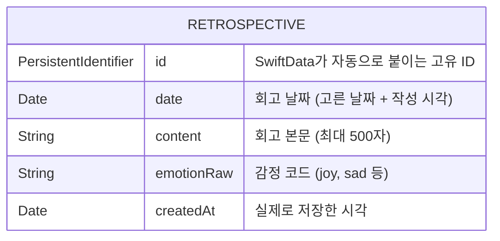

# Feelo 데이터 모델 (ERD)

Feelo는 서버 없이 **기기 안에만** 데이터를 저장합니다.
데이터베이스(SwiftData)에 저장되는 엔티티는 `Retrospective`(회고) **하나**이고, 다른 엔티티와의 관계는 없습니다.

## ERD



### dbdiagram.io용 DBML

[dbdiagram.io](https://dbdiagram.io)에 아래 코드를 붙여넣으면 같은 ERD를 그림으로 볼 수 있습니다.

<details>
<summary>DBML 코드 보기</summary>

```dbml
// Feelo 데이터 모델 (SwiftData)
// Docs: https://dbml.dbdiagram.io/docs

Enum Emotion {
  joy [note: '기쁨']
  achievement [note: '성취']
  stable [note: '안정 (모르는 값이면 이 값으로 처리)']
  angry [note: '분노']
  fear [note: '두려움']
  sad [note: '슬픔']
  exhausted [note: '소진']
}

Table Retrospective {
  id integer [pk, increment, note: 'SwiftData가 자동으로 만드는 고유 ID']
  date timestamp [not null, note: '회고 날짜 (고른 날짜 + 작성 시각)']
  content varchar(500) [not null, note: '회고 본문 (앱에서 500자로 제한)']
  emotionRaw Emotion [not null, note: '감정 코드 (Swift enum Emotion의 rawValue)']
  createdAt timestamp [not null, note: '실제로 저장한 시각. 같은 날 여러 개일 때 순서 기준']

  Note: 'SwiftData @Model Retrospective. 하루에 여러 개 저장 가능 (date 중복 허용)'
}

Note app_storage {
  '''
  DB 밖에 저장하는 값 (UserDefaults, @AppStorage)
  - hasSeenWelcome: 온보딩을 봤는지 (true / false)
  - appTheme: 테마 (system / light / dark)

  저장하지 않는 데이터
  - AI 주간 분석 결과: 메모리에만 보관
  - 통계: 회고 목록으로 그때그때 계산
  '''
}

// 예시 데이터 (실제 사용자 데이터 아님)
Records Retrospective(id, date, content, emotionRaw, createdAt) {
  1, '2026-11-16 21:30:00', '팀 프로젝트 첫 회의에서 역할을 정했다.', Emotion.joy, '2026-11-16 21:30:00'
  2, '2026-11-17 22:10:00', '발표 준비가 길어져서 지쳤다.', Emotion.exhausted, '2026-11-17 22:10:00'
  3, '2026-11-18 20:05:00', '기능 하나를 끝까지 완성했다.', Emotion.achievement, '2026-11-18 20:05:00'
}
```

</details>

## Retrospective (회고)

- 파일: `firstProject/firstProject/Models/Retrospective/Retrospective.swift`
- SwiftData `@Model` 클래스

| 필드 | 타입 | 설명 |
|---|---|---|
| (id) | `PersistentIdentifier` | SwiftData가 자동으로 만드는 고유 ID (코드에 직접 선언하지 않음) |
| `date` | `Date` | 어느 날의 회고인지. 작성 화면에서 고른 날짜에 작성 시각을 합쳐 저장 (지난 날짜도 고를 수 있음) |
| `content` | `String` | 회고 본문. 작성 화면에서 500자로 제한 (`RetrospectiveDraft.maxLength`) |
| `emotionRaw` | `String` | 감정 코드. `emotion` 속성으로 `Emotion` 값과 서로 바꿔 씀 |
| `createdAt` | `Date` | 실제로 저장한 시각. 같은 날 회고가 여러 개일 때 순서를 정하는 데 사용 |

### 참고

- **하루에 여러 개 저장 가능**: 날짜에 중복 금지 조건이 없습니다. 달력에는 그날의 가장 최근 회고 감정이 보입니다 (`Retrospective.latest(in:on:)`).
- **관계 없음**: `@Relationship`, `@Attribute(.unique)` 같은 설정은 쓰지 않습니다.

## Emotion (감정) — DB 테이블이 아닌 enum

- 파일: `firstProject/firstProject/Models/Emotion/Emotion.swift`
- 7개로 정해진 값이라 별도 테이블 없이 코드 안의 enum으로 두고, DB에는 `emotionRaw`에 글자(rawValue)로만 저장합니다.
- 저장된 글자가 목록에 없으면 `안정(stable)`으로 처리합니다 (`Emotion.fallback`).

| rawValue (DB에 저장되는 값) | 화면 이름 |
|---|---|
| `joy` | 기쁨 |
| `achievement` | 성취 |
| `stable` | 안정 |
| `angry` | 분노 |
| `fear` | 두려움 |
| `sad` | 슬픔 |
| `exhausted` | 소진 |

## DB 밖에 저장되는 값 (UserDefaults)

간단한 설정값은 `@AppStorage`(UserDefaults)에 저장합니다.

| 키 | 값 | 용도 |
|---|---|---|
| `hasSeenWelcome` | `true` / `false` | 온보딩 화면을 봤는지 |
| `appTheme` | `system` / `light` / `dark` | 테마 설정 |

## 저장하지 않는 데이터

| 데이터 | 처리 방식 |
|---|---|
| AI 주간 분석 결과 (`WeeklyReflectionAnalysis`) | 메모리에만 보관. 화면을 벗어나거나 앱을 다시 켜면 사라짐 |
| 통계 (감정 분포, 가장 많은 감정 등) | 저장하지 않고 회고 목록으로 그때그때 계산 (`Retrospective+Statistics.swift`) |
| AI 감정 추천 결과 | 작성 화면에서만 사용. 고른 감정만 회고와 함께 저장됨 |
